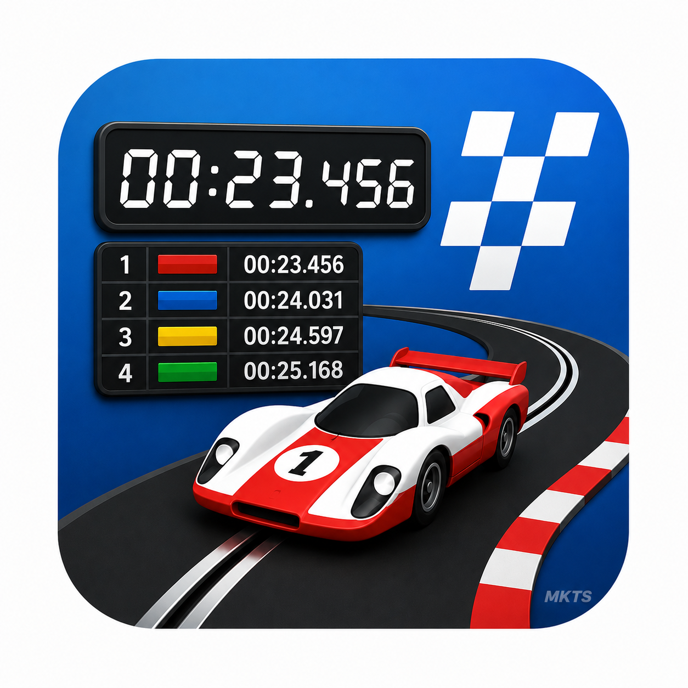
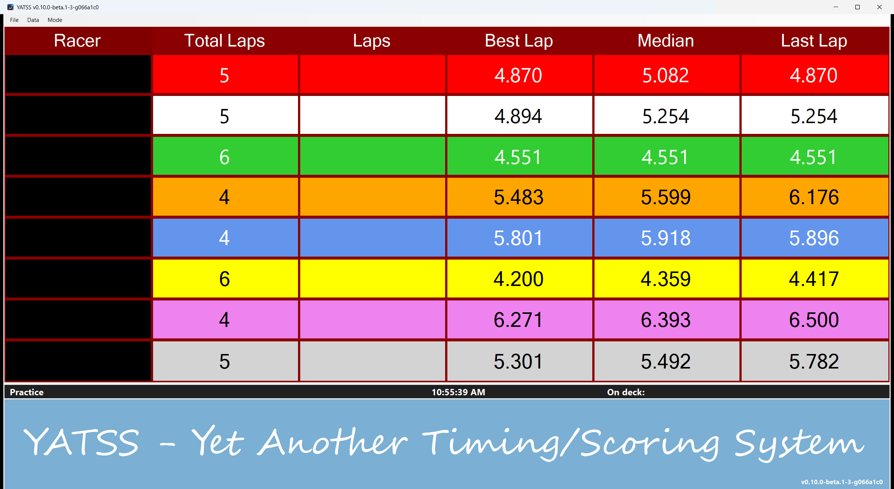
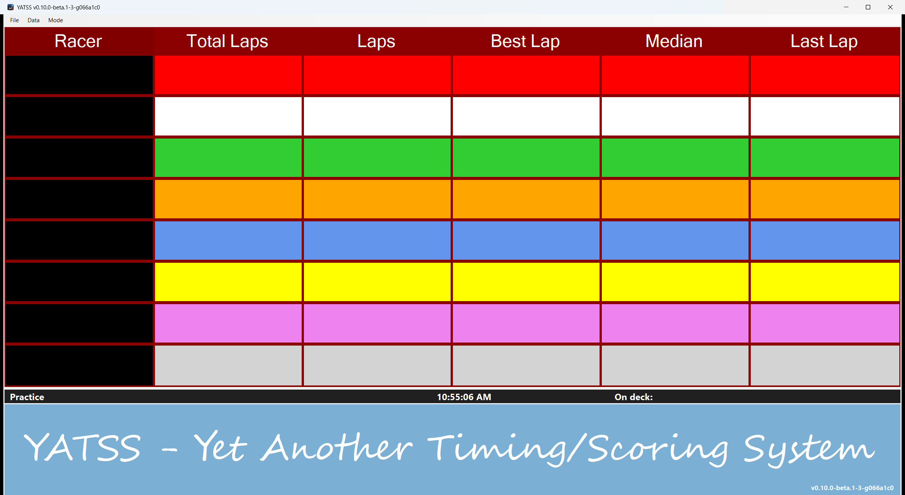
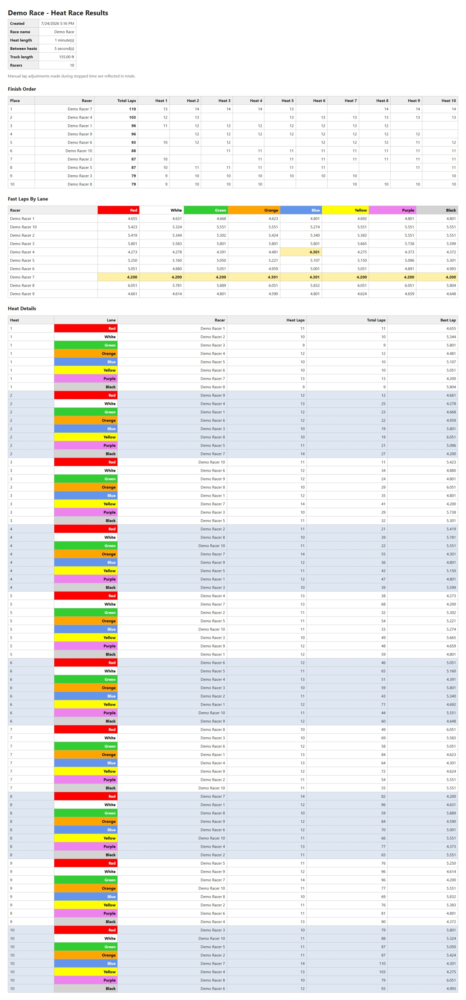

# YATSS



YATSS is an open-source slot-car lap timing and race-control system. A Windows
race board handles lap scoring, qualifying, heat rotation, reports, backups,
and operator workflow. An ESP32 or the integrated UNO Q microcontroller
timestamps sensor edges and controls up to eight lane-power relays.

> **Have a different microcontroller?** The supported-board list is a starting
> point, not a limit. Additional controllers can be added with a board-specific
> adapter to the shared controller core and appropriate hardware validation.
> [Tell us which board you have](https://github.com/tekrantz57/YATSS/issues) if
> hardware choice is holding you back. Unsupported boards are not yet plug-and-play.

> **New in 0.25: a Windows installer.** Self-contained setup includes the app,
> firmware and offline guides; no separate .NET installation is needed. Portable
> ZIPs remain available. See [downloads below](#download-and-try-it).
>
> **Public beta:** `v0.25.0-beta.3` is intended for evaluation, demo races, and
> careful bench testing. YATSS has no production track installations yet.

[](docs/images/yatss-demo-race-heat-2.png)

## Download and Try It

Download the Windows installer or a portable ZIP from
[GitHub Releases](https://github.com/tekrantz57/YATSS/releases):

- `YATSS-v0.25.0-beta.3-win-x64-setup.exe` is the recommended native Windows
  installer: per-user installation, Start-menu entry, optional desktop shortcut,
  and uninstall that preserves race data. Close YATSS before updating/removing it.
- `YATSS-v0.25.0-beta.3-win-arm64-setup.exe` is the experimental native Windows
  ARM64 installer; native ARM64 installation validation remains pending.
- `YATSS-win-x64-v0.25.0-beta.3.zip` is self-contained and does not require a
  separately installed .NET runtime.
- `YATSS-win-x64-requires-dotnet10-v0.25.0-beta.3.zip` is smaller and requires
  the x64 .NET 10 Desktop Runtime.
- `YATSS-win-arm64-v0.25.0-beta.3-experimental.zip` is a self-contained,
  experimental Windows ARM64 build.
- `YATSS-UNOQ-AppLab-v0.25.0-beta.3.zip` contains the experimental integrated
  controller application for import into Arduino App Lab on an UNO Q.

1. Verify the download against `YATSS-v0.25.0-beta.3-SHA256.txt`.
2. Run setup on native Windows, or extract the complete ZIP to a writable folder.
   Use ZIPs, not the installers, under Wine.
3. Launch YATSS from the Start menu or run `YATSSWin.exe` from the extracted ZIP.
4. Select `Mode > Demo Race...`; it starts Simulated Lap Input automatically so
   the race can run without controller hardware.

The executable is not code-signed, so Windows may show a reputation warning for
the prerelease. Verify the GitHub source and checksum before running it.

## Screenshots

<table>
  <tr>
    <th>Simulated practice</th>
    <th>Idle timing board</th>
  </tr>
  <tr>
    <td><a href="docs/images/yatss-practice.png"></a></td>
    <td><a href="docs/images/yatss-idle.png"></a></td>
  </tr>
</table>

<p align="center">
  <a href="docs/images/yatss-demo-race-report.jpeg">
    
  </a><br>
  <sub>Completed demo race report. Select the thumbnail for the full-size view.</sub>
</p>

## Capabilities

Development builds also offer a safe startup prompt when the identified
controller has older firmware than its matching validated bundle. Updates remain
explicitly confirmed; see [firmware updates](docs/CONTROLLER_FIRMWARE_UPDATE.md).

Development source adds [controller-side Practice sensor arming](docs/PRACTICE_SENSOR_ARMING.md):
select a test lane subset under Mode; unselected sensor interrupts are detached.
Matching updated firmware is required. This is not in the current release downloads.

Current development source also includes [Lap Finish racing](docs/LAP_FINISH.md):
a single fixed-lane race where the first racer to the selected lap target wins
and stops all lanes. This addition is not yet in the `v0.25.0-beta.3` downloads.
Choose **Mode > Lap Finish Demo...** for a hardware-free 10-lap example.

Version 0.25 includes the first version of
[Combined Distance Racing](docs/COMBINED_DISTANCE.md), with distance qualifying,
independent racer groups, director-approved finishing fractions, and a separate
Live Standings window, plus [active event recovery](docs/ACTIVE_RACE_RECOVERY.md)
and the [normally open relay setup](docs/RELAY_WIRING.md), plus independent
ordinary heat groups, race archives, controller-session verification, a TCP test
controller and copyable offline Help. See the
[0.25 release notes](docs/RELEASE_0.25.0-beta.3.md) for changes and validation limits.

- Practice timing and demo lap generation.
- Optional qualifying with track calls and active-time scoring.
- Multi-heat races for more racers than lanes, including timed or manually
  paused intermissions.
- Heat lengths from 1 second through 24 hours (86,400 seconds), entered in seconds.
- HTML reports and configurable JSON and CSV exports, with restart-safe retries.
- Manual and automatic database backups with verified restore.
- Live controller diagnostics and track-power relay pulse tests.
- In-app controller firmware installation for Waveshare ESP32-C5 N16R8,
  ESP32-C6 N4/N8, and Arduino Nano ESP32, with automatic flash-capacity
  selection.
- Optional Windows SAPI or native Linux/Wine voice announcements and Logitech
  R500s Next-button race control.
- Controller watchdog that cuts all lanes when Windows communication stops.
- Controller-loss pauses and verified, operator-initiated recovery with power
  held off during reconnection.
- Automatic unfinished-event saving and startup recovery, preserving laps,
  remaining heat time, rotations, and pending distance approvals with power off.

Event recovery uses a separate `ActiveRace.db` journal beside the settings
database; settings backups do not include it. Unknown outage crossings still
require director review. Practice sessions are not journaled.

## Architecture

Experimental controller addition in development source: [Pico 2 W USB
adapter](YATSSPico/README.md), reusing the existing shared controller core.
IDE/CLI/UF2 builds are supported; in-app Pico flashing and physical acceptance
are not yet complete. This is not included in the current release downloads.

- `YATSSWin` is the .NET 10 Windows Forms race-control application.
- `YATSSMC` is the shared ESP32-C5, ESP32-C6, and Arduino Nano ESP32 controller
  sketch.
- `YATSSUnoQ` is an experimental Arduino App Lab controller that uses the UNO
  Q's STM32U585 and presents it to YATSS over localhost TCP.
- Local UNO Q firmware updates can be initiated from YATSS under Wine using
  the optional authenticated [Linux update helper](docs/UNO_Q_UPDATES.md).
  Initial App Lab provisioning and end-to-end update bench testing are still required.
- `Controller` owns shared firmware logic and version identity; both sketches
  include synchronized self-contained copies for IDE, CLI, and App Lab builds.

Protocol 5 identifies each controller timing session explicitly, detects resets
without relying on clock rollback, and rejects retired-session messages and
stale power-enable commands. App and firmware must be updated together; see
[controller recovery](docs/CONTROLLER_RECOVERY.md). Physical reset/reconnect
bench checks remain required.

The controller timestamps debounced sensor edges and reports them over serial.
The Windows app owns lap counting, heat-race state, qualifying, reports,
logging, filtering, and track-power commands.

## Hardware Status and Safety

The Arduino Nano ESP32 profile remains supported. The ESP32-C6-DevKitC-1 V1.2
profile compiles, uploads, and communicates through its CP2102N UART connector;
complete eight-lane sensor, relay, watchdog, and production-harness validation
is still pending. The Waveshare ESP32-C5-WIFI6-KIT-N16R8 profile compiles and
has a packaged firmware image; its pin map, UART communication, flashing, and
complete hardware behavior still require bench validation.

The integrated UNO Q STM32U585 controller sketch compiles with Arduino Zephyr
0.90.0 and RouterBridge 0.4.3. App Lab deployment and localhost Bridge/TCP
transport passed an overnight demo-lap soak test. The active-low lane 1 sensor
input on D2 has been validated end to end on UNO Q hardware. Lanes 2-8, relay
outputs, watchdog behavior, and high-speed matrix-enabled sensing remain
bench-test work.

The communication watchdog cuts all lanes after five seconds without Windows
acknowledgements, provided that the controller and relay-coil supply remain
powered. Current firmware uses **normally open contacts: energize to run**,
with an external gate pulldown. Follow [Relay wiring](docs/RELAY_WIRING.md) before
connecting power. Bench-test every lane and retain an independent emergency
cutoff; normally open contacts do not protect against welded contacts.

## Platform Status

| Environment | Status |
| --- | --- |
| Windows x64 | Primary supported application environment |
| Wine on x64 Linux | Experimental; app and mapped COM-port heartbeats verified |
| Wine on ARM64 Linux | Experimental; ARM64 app, redirected UI, and mapped COM-port heartbeats exercised on Rock5B |
| Wine on Arduino UNO Q | Experimental; App Lab STM32 controller and localhost TCP transport passed an overnight demo-lap soak test |

Under Wine, map the Linux serial device to a Wine COM port and select that COM
port in YATSS. Directly entering `/dev/ttyUSB0` in the Windows application is
not sufficient. Native Linux speech is available through the packaged
loopback helper; see [Linux speech under Wine](docs/LINUX_SPEECH.md).

## Windows Installer

An optional per-user, self-contained Windows installer can be built with
`tools/Build-Installer.ps1`. ZIP downloads remain available, particularly for
Wine. Setup never installs drivers or flashes controllers, and uninstall retains
race data. See [Windows installation and build guide](docs/WINDOWS_INSTALLER.md).

## Repository Layout

```text
YATSSWin/
  YATSS.sln                         Windows solution
  YATSS/                            Windows Forms application
    Properties/PublishProfiles/     x64 and ARM64 publish definitions
  YATSS.Tests/                      lightweight integration test runner
  YATSS.Protocol/                   portable shared app protocol parser
  YATSS.Simulator/                  loopback TCP fault-test controller

Controller/                         canonical cross-platform controller core and version
tests/controller/                   native shared-controller behavior tests
installer/                          Inno Setup definition for optional Windows setup

YATSSMC/
  YATSSMC.ino                       ESP32 pin/ISR/serial adapter
  src/YatssController/              generated self-contained shared core
  FirmwareVersion.h                generated controller firmware identity
  dist/                             packaged C5/N16R8, C6/N4, C6/N8, and Nano firmware

YATSSUnoQ/                          UNO Q MCU adapter and Linux Bridge app
  sketch/src/YatssController/       generated self-contained shared core

tools/
  Build-ControllerFirmware.ps1     reproducible firmware package builder
  Sync-ControllerCore.ps1           shared-core synchronization and drift check
  Test-ControllerCore.ps1           common firmware behavior tests
  yatss-speech-helper.py            loopback eSpeak NG and Piper bridge

docs/                              protocol, hardware, release, and test guides

README.md                          project overview and build entry point
TODO.md                            active engineering backlog
CONTRIBUTING.md                    contribution and diagnostic-data guidance
LICENSE                            MIT project license
```

## Build and Test

From the repository root:

```powershell
./tools/Sync-ControllerCore.ps1 -Check
dotnet build YATSSWin\YATSS.sln -c Release
dotnet run --project YATSSWin\YATSS.Tests\YATSS.Tests.csproj -c Release
arduino-cli compile --fqbn arduino:esp32:nano_nora YATSSMC
arduino-cli compile --fqbn "esp32:esp32:esp32c5:CDCOnBoot=default,CPUFreq=240,FlashFreq=80,FlashMode=qio,FlashSize=16M,PartitionScheme=fatflash,PSRAM=enabled" YATSSMC
arduino-cli compile --fqbn "esp32:esp32:esp32c6:CDCOnBoot=default,FlashSize=4M,PartitionScheme=default" YATSSMC
arduino-cli compile --fqbn "esp32:esp32:esp32c6:CDCOnBoot=default,FlashSize=8M,PartitionScheme=default_8MB" YATSSMC
arduino-cli compile --fqbn arduino:zephyr:unoq YATSSUnoQ/sketch
```

Native controller tests use `./tools/Test-ControllerCore.ps1` with the Visual
Studio C++ toolchain and Windows SDK installed. On Linux, use
`bash tools/test-controller-core-linux.sh`. UNO Q compilation additionally
requires RouterBridge 0.4.3 and its dependencies; see the controller guide.

Visual Studio Community and VS Code with C# Dev Kit can both build the Windows
solution. The Windows application targets .NET 10 LTS.

## VS Code

Open the repository root in VS Code, not the `YATSSWin` subfolder, and install
the recommended extensions when prompted. The checked-in tasks cover the common
local workflow:

- `build: app debug`
- `build: app release`
- `test: protocol and lap race`
- `publish: app folder`
- `firmware: nano esp32`
- `firmware: esp32-c5 waveshare n16r8`
- `firmware: esp32-c6 n4`
- `firmware: esp32-c6 n8`

The `Launch YATSSWin` debug configuration builds the Debug solution and starts
the Windows Forms app. Visual Studio remains the preferred tool for WinForms
designer work. The firmware tasks assume `arduino-cli` and the matching Arduino
board cores are already installed.

## Documentation

The app's **Help** menu opens packaged guides offline, including a quick start,
installer checklist, race operation, pin maps, wiring and troubleshooting.
**Copy Version Information** provides build/platform/controller details without
racer names, personal paths or connection addresses; **Report a Bug** opens GitHub.

- [Windows application](YATSSWin/README.md)
- [Quick start and demo](docs/QUICK_START.md)
- [Installer commissioning checklist](docs/COMMISSIONING_CHECKLIST.md)
- [Controller sketch, pin maps, and wiring](YATSSMC/README.md)
- [Shared controller core and maintenance](docs/SHARED_CONTROLLER.md)
- [Normally open relay wiring and bench checks](docs/RELAY_WIRING.md)
- [Combined Distance Racing](docs/COMBINED_DISTANCE.md)
- [Independent groups for ordinary heat races](docs/INDEPENDENT_HEAT_GROUPS.md)
- [Controller firmware updates](docs/CONTROLLER_FIRMWARE_UPDATE.md)
- [Arduino UNO Q integrated controller](docs/UNO_Q_CONTROLLER.md)
- [UNO Q updates from YATSS: helper setup and recovery](docs/UNO_Q_UPDATES.md)
- [TCP test controller: isolated app tests and fault injection](docs/TCP_CONTROLLER_SIMULATOR.md)
- [Serial protocol](docs/SERIAL_PROTOCOL.md)
- [Race reports and data exports](docs/RACE_DATA_EXPORT.md)
- [Race archive browser and retention](docs/RACE_ARCHIVES.md)
- [Database backup and restore](docs/DATABASE_BACKUP.md)
- [Piper speech on Windows and Linux](docs/PIPER_SPEECH.md)
- [Linux speech under Wine](docs/LINUX_SPEECH.md)
- [Building the ARM64 Wine and UNO Q packages on Linux](docs/LINUX_BUILD.md)
- [Windows publish smoke test](docs/PUBLISH_SMOKE_TEST.md)
- [Packaged Windows/Wine software regression validation](docs/SOFTWARE_VALIDATION.md)
- [Troubleshooting](docs/TROUBLESHOOTING.md)
- [Controller connection loss and recovery](docs/CONTROLLER_RECOVERY.md)
- [Active event recovery after closing or crashing YATSS](docs/ACTIVE_RACE_RECOVERY.md)
- [Director-controlled current-heat reruns](docs/HEAT_RERUNS.md)
- [0.20 Beta 2 release notes](docs/RELEASE_0.20.0-beta.2.md)
- [0.25 Beta 3 release notes](docs/RELEASE_0.25.0-beta.3.md)
- [0.10 Beta 1 release notes](docs/RELEASE_0.10.0-beta.1.md)
- [Project backlog](TODO.md)

Questions, bug reports, and focused pull requests are welcome. See
[CONTRIBUTING.md](CONTRIBUTING.md) before posting logs or local data.

## License

YATSS is licensed under the [MIT License](LICENSE).
